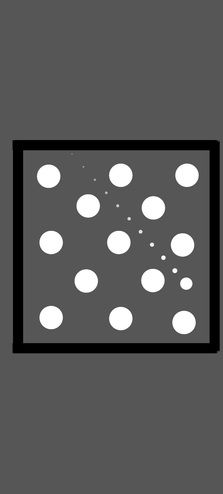
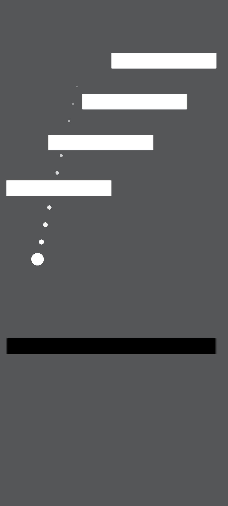
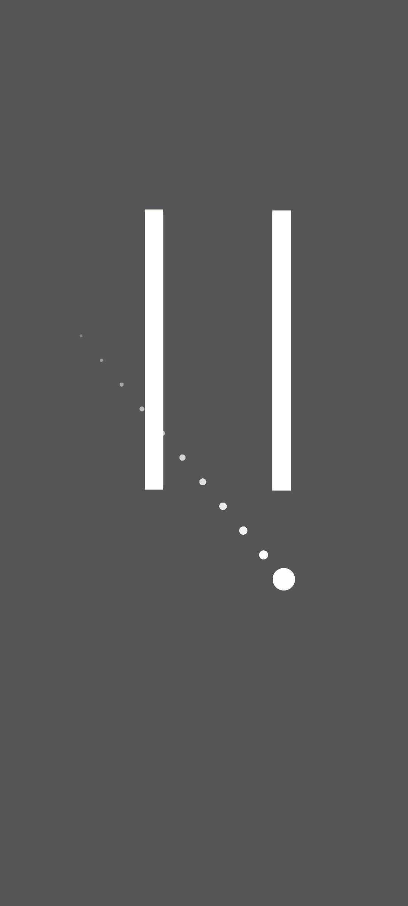

# REBOUND

<p align="center">
  <strong>A physics-based arcade puzzle game made with Unity and C#.</strong>
  <br />
  Aim carefully, bounce around obstacles, and hit every target to clear each level.
</p>

<p align="center">
  
  
  
  
</p>

---

## 🎮 About the Game

**Rebound** is a 2D mobile arcade puzzle game built around precision aiming and physics-based ball movement. Launch a ball, use walls and obstacles to your advantage, and destroy every target to move on to the next challenge.

## 🕹️ How to Play

1. Touch and drag anywhere on the screen to spawn and aim the ball.
2. Pull back to set your shot.
3. Release to launch.
4. Use rebounds and obstacle interactions to hit every target.
5. Clear all targets to complete the level.
6. If the ball is still moving, tap the screen to restart the current level.

## ✨ Features

- **16 level prefabs** with handcrafted layouts.
- Physics-based movement, collisions, and rebounds.
- Moving and rotating obstacles.
- Multiple target and obstacle shapes.
- Aim indicators to help line up shots.
- Target-hit effects and level transition animations.
- Main menu, pause, and win UI.
- Sound effects and gameplay audio.
- Touchscreen controls for Android.
- Portrait-oriented mobile gameplay.

## 🛠️ Built With

| Technology | Use |
|---|---|
| Unity 6.0.4f1 | Game engine |
| C# | Gameplay and game systems |
| Unity 2D Physics | Ball movement and collisions |
| Android | Target platform |

## 📁 Project Structure

```text
Assets/
├── Prefabs/
│   ├── Levels/
│   ├── Targets/
│   └── Effects/
├── Scenes/
└── Scripts/
    ├── Effects/
    ├── Gameplay/
    ├── Managers/
    ├── Obstacles/
    ├── Player/
    └── UI/
Packages/
ProjectSettings/
```

## 🚀 Open the Project

1. Install **Unity 6.0.4f1** using Unity Hub.
2. Clone this repository:
   ```bash
   git clone https://github.com/sanchitory19-stack/Rebound-Unity-Game.git
   ```
3. In Unity Hub, select **Add project from disk** and choose the cloned folder.
4. Open the project and allow Unity to import its assets.

## 📱 Android Build

The project is configured for Android portrait gameplay.

An installable APK will be published under [GitHub Releases](https://github.com/sanchitory19-stack/Rebound-Unity-Game/releases) when the public build is uploaded.

## 📸 Screenshots

<p align="center">
  
  
  
</p>

---

<p align="center">
  Made independently with Unity.
</p>
